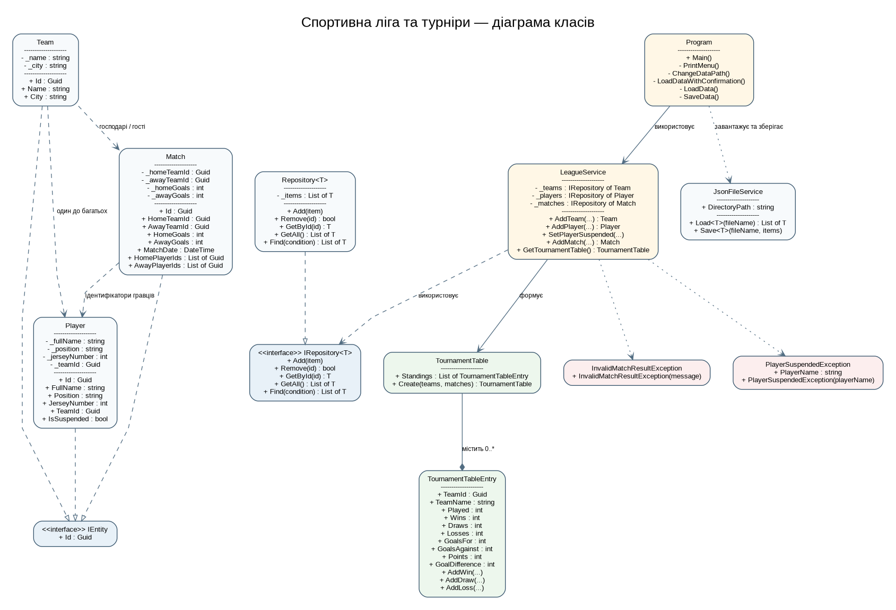

# Спортивна ліга та турніри — курсова робота з ООП (варіант 24)

Консольний застосунок мовою **C# / .NET 8** для ведення спортивної ліги. Програма дає змогу зберігати команди, гравців і результати матчів, контролювати дискваліфікації та автоматично формувати турнірну таблицю.

## Діаграма класів



## Можливості програми

- додавання та перегляд команд;
- додавання та перегляд гравців;
- призначення та скасування дискваліфікації гравця;
- реєстрація результатів матчів із зазначенням складів команд;
- перевірка, що дискваліфікований гравець не потрапить до складу матчу;
- нарахування очок: перемога — 3, нічия — 1, поразка — 0;
- автоматичне формування та сортування турнірної таблиці;
- збереження та завантаження команд, гравців і матчів у форматі JSON;
- можливість самостійно вказати шлях до папки з JSON-файлами;
- можливість вручну завантажити дані з вибраної папки та зберегти дані в неї.

## Структура проєкту

```text
SportsLeagueTracker/
├── SportsLeagueTracker.sln
├── README.md
├── CLASS_DIAGRAM.md
├── diagrams/
│   ├── class-diagram.mmd
│   ├── class-diagram.dot
│   ├── class-diagram.png
│   └── class-diagram.svg
├── Data/
└── src/
    ├── SportsLeague.Core/             # бібліотека бізнес-логіки (DLL)
    │   ├── Exceptions/                # власні винятки
    │   ├── Interfaces/                # інтерфейси
    │   ├── Models/                    # класи предметної області
    │   ├── Repositories/              # узагальнене сховище List<T>
    │   └── Services/                  # логіка ліги та JSON-серіалізація
    └── SportsLeague.ConsoleApp/        # консольний інтерфейс українською
```

## Вимоги

- .NET SDK 8.0 або новіший;
- Windows, Linux або macOS.

## Запуск

Відкрийте термінал у кореневій папці проєкту та виконайте:

```bash
dotnet restore
dotnet build
dotnet run --project src/SportsLeague.ConsoleApp/SportsLeague.ConsoleApp.csproj
```

Також можна відкрити файл `SportsLeagueTracker.sln` у Visual Studio та запустити проєкт `SportsLeague.ConsoleApp`.

## Робота із JSON-файлами та шляхами

Під час запуску програма за замовчуванням використовує папку `Data`, розташовану біля виконуваного застосунку. Під час старту вона намагається прочитати з цієї папки три файли:

- `teams.json` — список команд;
- `players.json` — список гравців;
- `matches.json` — матчі та склади команд.

У головному меню є три окремі пункти для керування файлами:

1. **«Вказати шлях до папки з JSON-файлами»** — введіть повний шлях до папки, наприклад `C:\Users\User\Documents\SportsLeagueData`. Шлях можна вводити з пробілами. Папка може ще не існувати — вона буде створена під час першого збереження.
2. **«Завантажити дані з вибраної папки»** — програма прочитає `teams.json`, `players.json` і `matches.json` із вибраної папки. Перед завантаженням програма попросить підтвердження, оскільки поточні дані в пам'яті буде замінено.
3. **«Зберегти дані у вибрану папку»** — програма запише всі три JSON-файли у вказану папку.

Під час виходу програма також автоматично зберігає дані в поточну папку. Якщо потрібного JSON-файлу немає, під час завантаження для відповідного списку буде використано порожню колекцію.

**Приклад роботи:** виберіть пункт 9, введіть `D:\Курсова ООП\Дані Ліги`, потім виберіть пункт 10 для читання даних із цієї папки або пункт 11 для запису поточних даних у неї.

## Правила нарахування очок

| Результат матчу | Очки |
|---|---:|
| Перемога | 3 |
| Нічия | 1 |
| Поразка | 0 |

Порядок сортування турнірної таблиці: кількість очок (за спаданням), різниця голів (за спаданням), кількість забитих голів (за спаданням), назва команди (за алфавітом).

## Основні класи

- `Team` — команда та її місто;
- `Player` — гравець, його номер, позиція та статус дискваліфікації;
- `Match` — матч, рахунок, дата та списки гравців у складах;
- `TournamentTable` — автоматичне формування турнірної таблиці;
- `TournamentTableEntry` — статистика окремої команди;
- `LeagueService` — основні правила роботи спортивної ліги;
- `Repository<T>` — узагальнене сховище об'єктів на основі `List<T>`;
- `JsonFileService` — читання та запис колекцій у JSON за вказаним шляхом.

## Власні винятки

- `InvalidMatchResultException` — некоректний результат матчу, зокрема спроба створити матч команди із самою собою або вказати від'ємний рахунок;
- `PlayerSuspendedException` — спроба включити дискваліфікованого гравця до складу матчу.


## Використані технології

- C#;
- .NET 8;
- `List<T>` для зберігання об'єктів;
- власні та стандартні інтерфейси;
- `System.Text.Json` для серіалізації та десеріалізації;
- поділ рішення на бібліотеку класів `SportsLeague.Core` та консольний застосунок `SportsLeague.ConsoleApp`.
